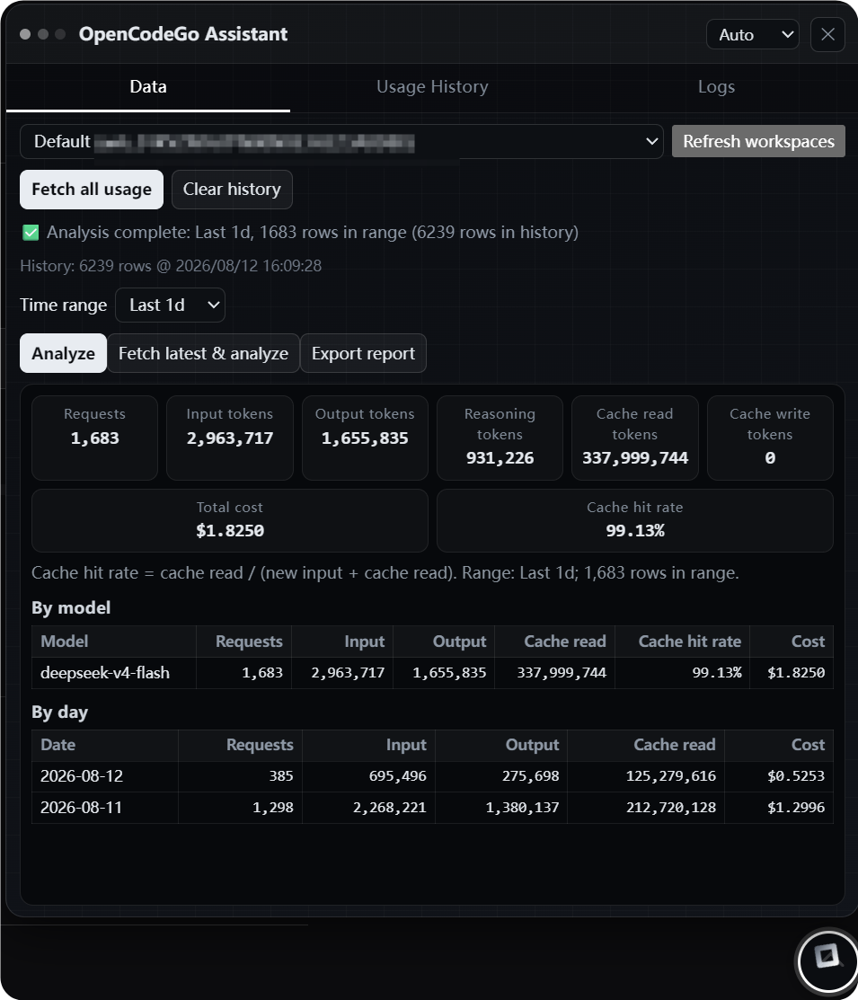
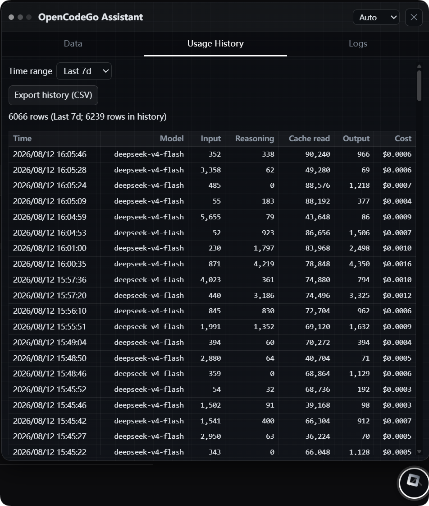

<p align="center">
  
</p>

<div align="center">

# OpenCodeGo Usage Assistant (Userscript) v0.9.7

Fully fetch and persist your usage history on the `https://opencode.ai` dashboard, with **usage analytics** (Today / 1d / 7d / 30d / All / Custom — input/output, cache hit rate, cost) and **usage history**.

- Same page contract: `POST /_server`, params sent as a seroval JSON body (with `X-Server-Id` / `X-Server-Instance` headers).
- Content fingerprint dedup: identical `request time + input/output/reasoning/cache reads (+cache writes/model/cost)` => same record.
- Persistent history (IndexedDB); when history is complete, full fetch **stops paging as soon as history is hit**; when incomplete, it pages to the end and marks itself complete.
- Full fetch can be stopped, is mutually exclusive, and prevents duplicate pages; logs are persisted; the panel is draggable/resizable and remembers its size; **Chinese/English UI**.

</div>

<p align="center">
  
  
</p>


## Files

| File                             | Description            |
| -------------------------------- | ---------------------- |
| `opencodego-dashboard.user.js` | Main userscript        |
| `seroval-core.cjs`             | seroval codec core     |
| `test-seroval-core.cjs`        | Node unit tests        |
| `test-userscript.py`           | Playwright smoke tests |

## Installation

1. **Install Tampermonkey** (if not already installed):
   - [Chrome Web Store](https://chrome.google.com/webstore/detail/tampermonkey/dhdgffkkebhmkfjojejmpbldmpobfkfo)
   - [Firefox Add-ons](https://addons.mozilla.org/en-US/firefox/addon/tampermonkey/)
   - [Edge Add-ons](https://microsoftedge.microsoft.com/addons/detail/tampermonkey/iikmkjmpaadaobahmlepeloendndfphd)

2. **Install the script**:
   - Click: [**Install OpenCodeGo Dashboard Assistant**](https://raw.githubusercontent.com/HIUEETR/OpenCodeGo-Dashboard/main/opencodego-dashboard.user.js)
   - Tampermonkey will prompt you to install → click **Install**

3. **Sign in** to `https://opencode.ai` and the script will activate automatically.

The script will **auto-update** when new versions are released.

## Usage (Data / Usage History / Logs)

- **Data page (with analytics)**:
  - Refresh workspace / **Fetch full usage** (stops early when complete history is hit) / Clear history;
  - Time range (Today / 1d / 7d / 30d / All / Custom) → **Run analysis** or **Fetch latest & analyze**;
  - Metric cards (requests / input / output / reasoning / cache read / cache write / cost / cache hit rate), per-model breakdown (including per-model cache hit rate), daily details, and analysis report export.
- **Usage History page**: tabular view of **recent API usage and costs** — column order: request time, model, **input, reasoning, cache read, output, cost ($)**;
  24-hour time format `yyyy/MM/dd HH:mm:ss`; supports time range (Today / 1d / 7d / 30d / All / Custom), up to 300 rows, **CSV export**.
- **Logs page**: copy / export / clear.
- Panel: resize by dragging **edges/corners**; the “Clear history” button clears persisted data.

## Misc

- **Fingerprint dedup**: identical `timeCreated | inputTokens | outputTokens | reasoningTokens | cacheReadTokens | cacheWrite5mTokens | cacheWrite1hTokens | model | cost` => same record.
- **Persistence**: no TTL, no expiry — only “Clear history” deletes; `complete` marks whether the full history has been fetched.
- **Stop on history hit**: only active when history is complete — on a subsequent fetch, paging stops as soon as the current page contains a record matching an existing fingerprint; new data is merged with history by fingerprint; **when history is incomplete, it never stops early** — it pages to the end and marks itself complete (to avoid false “incomplete history” reports).
- **Stop button**: while a task is running, the Data page shows ⏹ Stop; clicking it immediately aborts and keeps what has been fetched so far.

## Testing

```powershell
node test-seroval-core.cjs
python test-userscript.py
```
