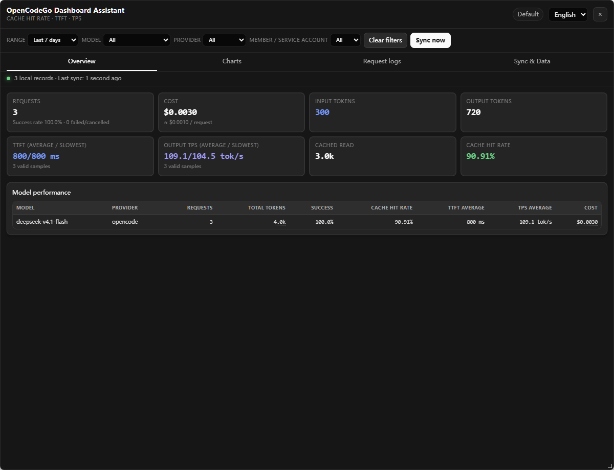
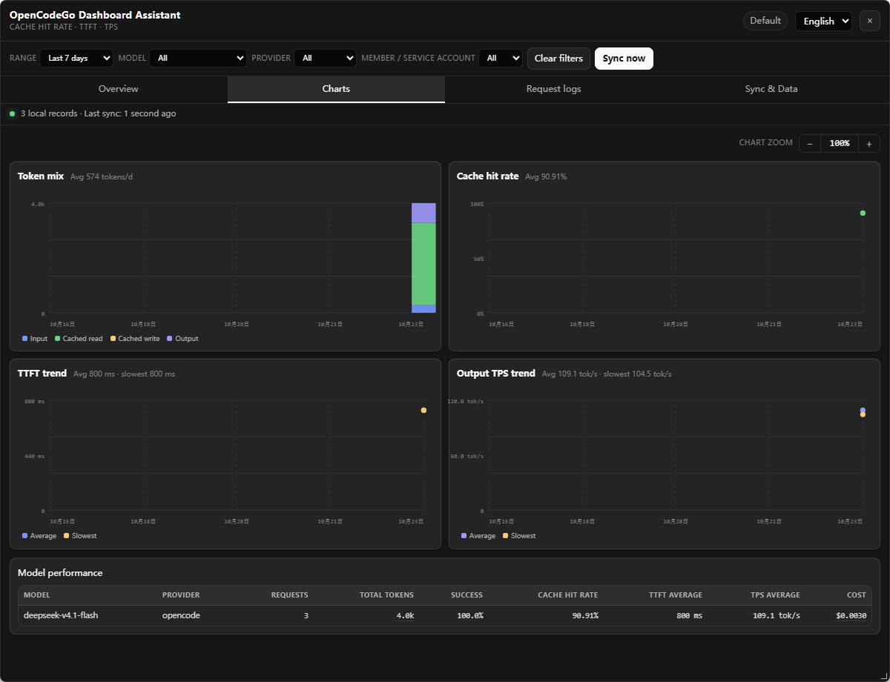

<p align="center">
  
</p>

# OpenCodeGo Dashboard Assistant (Userscript) v1.4.0

**[中文](README.zh-CN.md)** | English

OpenCodeGo Dashboard Assistant adds a floating dashboard to [OpenCode Console](https://opencode.ai/console/) that brings together request performance and OpenCode Go usage.

## Screenshots

### Overview



### Charts



## Features

- Time-range presets for the last 1 hour, 5 hours, 24 hours, 7 days, 30 days, all local history, or a custom interval, with model, provider, and member / service account filters.
- Overview cards for requests, success rate, cost, input/output tokens, TTFT, output TPS, cached read/write, and cache hit rate.
- Cache hit rate: `cacheRead / (input + cacheRead + cacheWrite + cacheWrite1h)`; missing write buckets count as zero.
- TTFT and TPS use only successful streaming requests. When at least five samples are available, averages are calculated after removing about 1% from each tail (at least one value per tail); slowest values still use every valid sample.
- Trend charts for token mix, cache hit rate, TTFT average/slowest, output TPS average/slowest, and model performance, with chart zoom and hover details.
- Request logs with status, model, provider, TTFT, TPS, tokens, cost, and member / service account, plus links to the official Console log detail.
- Model tables show total tokens and cost, with a hover breakdown. Costs are estimated from OpenCode Go prices.
- The Sync & Data tab shows cached model pricing, Peak / Off-Peak periods, context tiers, browser storage, diagnostics, and export controls.
- Local IndexedDB archive keeps compact request metrics beyond the Console's 30-day log retention window.
- Chinese or English UI, remembered filters, time range, current tab, language, panel size, launcher position, and chart zoom.

## Data sources and compatibility

The userscript uses the current same-origin OpenCode Console endpoints:

- `GET /console/api/user/workspaces`
- `GET /console/api/request-logs?category=inference&since=...&limit=50...`
- `GET /console/api/usage/users?range=30d&page=...&pageSize=100&costOrder=desc`
- `GET /v2/docs/console/go/`

The request-log endpoint requires the current workspace in `x-org-id` and uses the `opencode.ai` session cookie. The script also observes the Console's own same-origin inference request-log responses and saves matching pages that identify a `wrk_` workspace, so opening the official log page can seed local data without a second request.

If OpenCode changes these routes or fields, include the copied diagnostics log in a [GitHub issue](https://github.com/HIUEETR/OpenCodeGo-Dashboard/issues).

## Sync behavior

- The first sync, an incomplete backfill, or a missing latest record starts a 30-day full sync. “Backfill 30 days” can force it manually.
- After the panel has been opened, the visible Console tab checks every 10 minutes. A check runs only if the last successful sync is about 9 minutes or older.
- Auto-sync pauses while the Console tab is hidden. It can continue after the panel is closed because the timer belongs to the Console page.
- Incremental sync starts from `max(30-day retention start, min(latest local record - 5 minutes, last successful sync - 1 hour))`.
- Records are deduplicated by `workspaceID:id`. The stable ID prefers the log `id`, then `requestID`, then a synthesized key.
- Each completed sync shows the number of new records or an up-to-date message.

If the Console is not opened for more than 30 days, the missed period cannot be recovered from the official API. The panel reports the history gap.

## Local data

Data stays in the current browser profile's IndexedDB and is not uploaded to third parties. Request and response headers, IP, and location data are not stored.

Legacy `ocgo-cache` records are imported once only for timestamps older than the current 30-day retention window. They have no TTFT/TPS but still contribute to request counts, success counts, token, cache, and cost analytics. Clearing local history also removes the legacy cache and prevents another import.

Use Sync & Data to export the currently filtered range as CSV or the complete workspace archive as JSON, copy diagnostics, or clear local history.

## Installation

1. Install [Tampermonkey](https://www.tampermonkey.net/) or another compatible userscript manager.
2. [Click here to install the userscript](https://raw.githubusercontent.com/HIUEETR/OpenCodeGo-Dashboard/main/opencodego-dashboard.user.js).
3. Confirm installation in the userscript manager.
4. Sign in to `https://opencode.ai/console/` and click the chart launcher.

TypeScript is build-time only. The release artifact is a single `.user.js` file and requires no browser-extension development setup or cloud service.

## Development

Requires Node.js 20 or newer.

```powershell
npm install
python -m pip install -r requirements-test.txt
python -m playwright install chromium
npm run build
npm run check
npm run test:e2e
```

After a local rebuild, re-import the generated userscript in the userscript manager.

## References

- [OpenCode Console documentation](https://opencode.ai/v2/docs/console/)
- [OpenCode Go usage limits](https://opencode.ai/v2/docs/console/go/)

## License

[MIT License](LICENSE) © 2026 HIU
