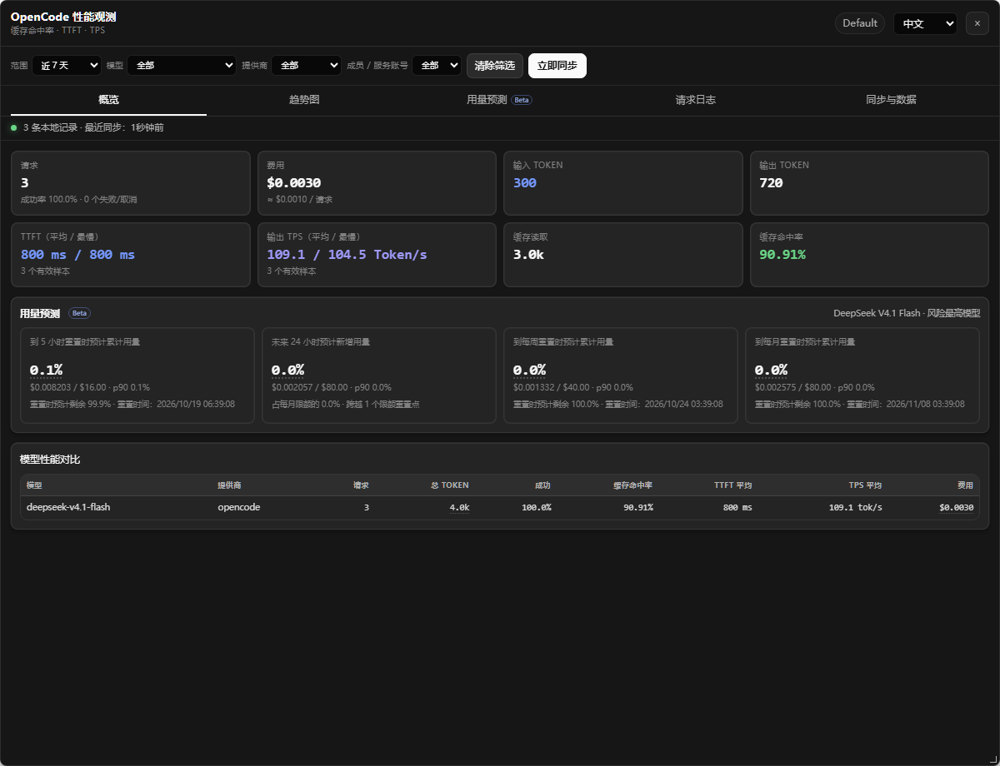
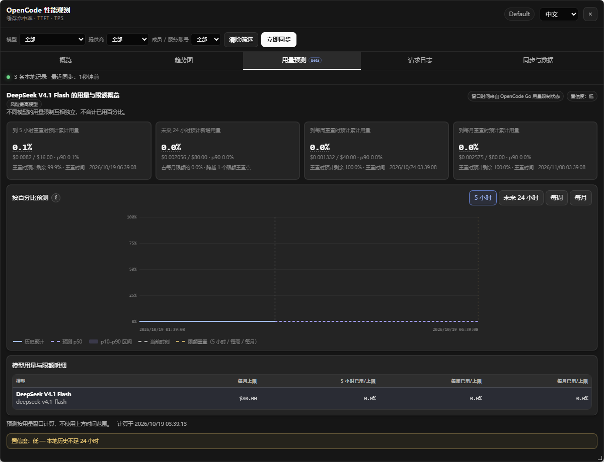

<p align="center">
  
</p>

# OpenCode 性能观测（油猴脚本）v1.2.0

中文 | **[English](README.md)**

OpenCode 性能观测会在 [OpenCode Console](https://opencode.ai/console/) 上增加一块悬浮仪表盘，集中展示请求性能、本地归档、OpenCode Go 价格和可选的使用量预测。账户、工作区、账单和权威用量仍以 OpenCode Console 为准。

## 界面截图

| 概览 | 用量预测 |
| --- | --- |
|  |  |

## 功能

- 概览卡片展示请求数、成功率、费用、输入/输出 Token、TTFT、输出 TPS、缓存读取/写入和缓存命中率。
- 缓存命中率：`cacheRead / (input + cacheRead + cacheWrite + cacheWrite1h)`；缺失的缓存写入字段按 0 处理。
- TTFT 和 TPS 只统计成功且流式的请求；TPS 还要求输出 Token 大于 0，并从首个输出 Token 计算到最后一个输出 Token。缺少时间字段时回退到 TTFT 与请求结束时间。
- 趋势图展示 Token 构成、缓存命中率、TTFT 平均/最慢、输出 TPS 平均/最慢和模型性能，支持图表缩放与悬浮详情。
- 请求日志展示状态、模型、提供商、TTFT、TPS、Token、费用和成员 / 服务账号，并可跳转到 OpenCode Console 的请求日志详情。
- 模型表展示总 Token 和费用，支持悬浮查看费用组成。费用按 OpenCode Go 单价估算；只有该模型所有请求都能匹配价格 tier 时，才把分类费用校准到日志总费用。
- “同步与数据”页展示模型价格缓存、高峰 / 空闲时段、上下文档位、浏览器存储、诊断日志和导出操作。
- 本地 IndexedDB 归档长期保存精简后的请求指标，不受 Console 30 天日志保留期限制。
- 可选 Beta 用量预测默认关闭。开启后概览增加预测摘要，并出现“用量预测”标签，包含 5 小时、未来 24 小时、每周和每月四张卡。
- 用量预测按模型独立计算：每月上限为 `M`，每周上限为 `M / 2`，5 小时上限为 `M / 5`。未来 24 小时是预测跨度，不是限额窗口。详见[实现说明](docs/usage-forecast-implementation.zh-CN.md)和[设计文档](docs/usage-forecast-design.zh-CN.md)。
- 支持中文和英文界面，并记忆筛选、时间范围、当前标签、语言、预测开关、面板尺寸、按钮位置和图表缩放。
- 图表按钮可开关面板并拖动；标题栏移动面板，八条边缘手柄调整尺寸；按 `Escape` 或点击面板外区域关闭。

## 数据来源与兼容性

脚本使用当前 OpenCode Console 的同源接口：

- `GET /console/api/user/workspaces`
- `GET /console/api/request-logs?category=inference&since=...&limit=50...`
- `GET /console/api/usage/users?range=30d&page=...&pageSize=100&costOrder=desc`
- `GET /console/api/go/status`
- `GET /v2/docs/console/go/`

请求日志接口需要当前工作区的 `x-org-id`，并依赖 `opencode.ai` 的会话 Cookie。脚本还会监听 Console 自己发出的同源推理请求日志响应，保存其中带 `wrk_` 工作区标识的记录；打开官方日志页即可直接补充本地数据，不需要重复请求。

脚本默认使用 `limit=50`，与官方日志页一致；如果服务端拒绝该页大小，会依次尝试 25 和 10。网络、限流和服务端错误最多重试 4 次；游标失效时从第一页重试一次，连续游标重复则停止同步，避免死循环。

使用的请求字段包括：

`id`、`requestID`、`workspaceID`、`startedAt`、`finishedAt`、`durationMs`、`timeToFirstTokenMs`、`firstTokenAt`、`lastTokenAt`、`inputTokens`、`outputTokens`、`reasoningTokens`、`cacheReadTokens`、`cacheWriteTokens`、`cacheWrite1hTokens`、`cost`、`model`、`provider`、`outcome`、`stream`、`userID`、`serviceAccountID`。

如果 OpenCode 更新接口或字段，请在 [Issues](https://github.com/HIUEETR/OpenCodeGo-Dashboard/issues) 中附上复制的诊断日志。

## 同步策略

- 首次同步、回填未完成或本地缺少最新记录时执行 30 天全量同步；也可以手动点击“补齐近 30 天”。
- 面板首次打开后，可见的 Console 标签页每 10 分钟检查一次；距离上次成功同步超过约 9 分钟才执行同步。
- 页面隐藏时暂停自动同步；面板关闭后，只要 Console 页面仍可见，定时同步仍可继续。
- 增量同步起点为 `max(30 天保留期起点, min(本地最新记录 - 5 分钟, 上次成功同步 - 1 小时))`。
- 记录按 `workspaceID:id` 去重；稳定 ID 优先使用日志 `id`，其次 `requestID`，最后使用合成键。
- 每次同步完成后显示新增数量或“已是最新”。

如果超过 30 天没有打开 Console，缺失期间的数据无法再从官方接口补回，面板会显示历史缺口。

## 用量预测

Beta 用量预测使用当前工作区的全部本地历史、OpenCode Go 价格缓存和 Go 用量限制状态，并应用当前模型、提供商和成员 / 服务账号筛选。

- 每个模型的用量独立评估，不把不同模型的限额相加。
- 5 小时、每周和每月窗口优先使用官方重置时间，否则使用 UTC 或尾随窗口估算。
- 曲线展示历史累计用量、p50 预测、p10–p90 预测区间、当前时刻和限额重置点。
- 风险最高模型是 5 小时、每周和每月三个窗口中最高 p90 利用率最大的模型。
- 缺少官方状态、历史过短、同步缺口、价格缓存过期或未定价请求超过 5% 时，置信度会降低。
- 同步期间已有预测卡和曲线保持可见；后台刷新只设置 `aria-busy`，新结果完成后才替换数据。

预测结果仅供估算，不改变官方用量限制。

## 本地数据

数据只保存在当前浏览器配置文件的 IndexedDB 中，不会上传到第三方。脚本不保存请求头、响应头、IP 和地区信息。

旧版 `ocgo-cache` 只会迁移时间早于当前 30 天保留窗口的记录，且只导入一次。旧记录没有 TTFT/TPS，但仍会计入请求数、成功数、Token、缓存和费用统计。清空本地历史时也会删除旧版缓存，并阻止再次导入。

可在“同步与数据”页把当前筛选范围导出为 CSV，把当前工作区的完整归档导出为 JSON，复制诊断日志或清空本地历史。

## 安装

1. 安装 [Tampermonkey](https://www.tampermonkey.net/) 或兼容的 userscript 管理器。
2. 打开[安装脚本](https://raw.githubusercontent.com/HIUEETR/OpenCodeGo-Dashboard/main/opencodego-dashboard.user.js)。
3. 在 userscript 管理器中确认安装。
4. 登录 `https://opencode.ai/console/`，点击图表按钮打开面板。

TypeScript 只用于开发；发布产物是单一 `.user.js` 文件，不需要浏览器扩展开发环境或云端服务。

## 开发

需要 Node.js 20 或更高版本。

```powershell
npm install
python -m pip install -r requirements-test.txt
python -m playwright install chromium
npm run build
npm run check
npm run test:e2e
```

- `npm run build`：将 `src/main.ts` 打包为根目录的 `opencodego-dashboard.user.js`。
- `npm run watch`：监听源码并持续重建 userscript。
- `npm test`：运行 Vitest 单元测试。
- `npm run test:watch`：以监听模式运行 Vitest。
- `npm run check`：类型检查加单元测试。
- `npm run test:e2e`：构建后用 Playwright 运行本地 Console 测试场景。
- `npm run capture:readme`：使用同一套本地 fixture 重新生成四张 README 截图。

本地重新构建后，需要在 userscript 管理器中重新导入生成的脚本。

## 参考

- [术语规范](docs/terminology.zh-CN.md)
- [用量预测设计](docs/usage-forecast-design.zh-CN.md)
- [用量预测实现说明与计算方式](docs/usage-forecast-implementation.zh-CN.md)
- [OpenCode Console 文档](https://opencode.ai/v2/docs/console/)
- [OpenCode Go 用量限制](https://opencode.ai/v2/docs/console/go/)

## 许可证

[MIT License](LICENSE) © 2026 HIU
