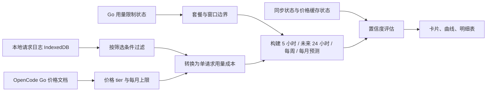

# 用量预测实现说明

本文说明 OpenCode Performance Lens 当前版本中“用量预测”的实际实现，包括数据来源、单请求用量成本、时间窗口、预测算法、风险排序、置信度和可复算示例。本文反映代码现状，不是后续规划。

界面名称为“用量预测 / Usage forecast”；内部仍保留 `QuotaForecast`、`quotaLimits` 等代码名兼容已有实现。预测结果仅供估算，不修改 OpenCode Go 的官方用量限制。

## 1. 数据流



主要代码路径：

| 文件 | 职责 |
| --- | --- |
| `src/api.ts` | 读取 `/console/api/go/status`，获得套餐、访问周期和各窗口重置时间。 |
| `src/storage.ts` | 从 IndexedDB 读取当前工作区的全部本地请求记录。 |
| `src/pricing.ts` | 解析 OpenCode Go 价格表、Go / Go Plus 每月上限，选择计价 tier 并计算单请求用量成本。 |
| `src/forecast.ts` | 分组、窗口预测、p10 / p50 / p90、风险排序和置信度。 |
| `src/ui/panel.ts` | 协调筛选、同步、价格缓存和预测刷新。 |
| `src/ui/forecastPanel.ts` | 渲染四张结果卡、曲线和模型明细表。 |
| `test/forecast.test.ts` | 验证限额派生、24 小时口径、无穷额和零消耗行为。 |

## 2. 输入数据

### 2.1 本地请求记录

预测读取当前工作区的全部本地历史，不只读取面板顶部选择的时间范围。记录先经过模型、提供商和成员 / 服务账号筛选，然后只保留 OpenCode 或 OpenCode Go 的推理请求。

每条记录的用量成本来自 Token 字段：

- `inputTokens`
- `outputTokens`
- `cacheReadTokens`
- `cacheWriteTokens`
- `cacheWrite1hTokens`

### 2.2 价格与每月上限

价格缓存来自 <https://opencode.ai/v2/docs/console/go/>，有效期 3 天。解析器读取 Go 和 Go Plus 两个套餐价格表，保存每个模型的 `Monthly limit`。模型显示名、模型 ID、高峰 / 空闲时段和上下文档位来自同一份价格文档。

### 2.3 Go 用量限制状态

`GET /console/api/go/status` 用于获得：

- 当前套餐是 Go 还是 Go Plus；
- 访问起止时间；
- 5 小时窗口的起止时间；
- 每周和每月窗口的重置时间。

该接口失败时，预测继续使用本地窗口，但置信度会降低。

## 3. 用量限制与时间窗口

### 3.1 单模型限额

每个模型的每月上限记为 `M`。不同模型的限额互相独立，不跨模型求和：

```text
每月上限 Mmonth = Monthly limit
每周上限 Mweek  = Mmonth / 2
5 小时上限 M5h = Mmonth / 5
```

未来 24 小时不是官方限额窗口，而是一个预测跨度。它的分母固定为每月上限：

```text
24H 用量比例 = 未来 24 小时预测新增用量 / Mmonth
```

### 3.2 官方窗口

Go 状态可用时：

- 5 小时窗口使用 `fiveHour.startsAt` 和 `fiveHour.resetsAt`。
- 每周窗口结束于 `week.resetsAt`，开始时间由 `week.resetsAt - 7 天` 推导。
- 每月窗口优先使用 `accessStartsAt` 作为开始；如果没有该字段，但 `month.resetsAt - 30 天` 不晚于当前时刻，则使用这个 30 天起点，否则使用 UTC 日历月第一天。结束时间依次使用 `month.resetsAt`、`accessEndsAt`。

### 3.3 本地降级窗口

Go 状态不可用时：

- 5 小时窗口使用 `now - 5 小时` 到 `now`。因为没有已知的未来重置时间，未来预测长度为 0，只展示当前窗口已用情况。
- 每周窗口使用 UTC 周一 00:00 到下周一 00:00。
- 每月窗口使用 UTC 日历月第一天到下月第一天。
- 套餐默认按 Go 处理，直到官方状态返回 Go Plus。

## 4. 单请求用量成本

设：

- `I`、`O`、`CR`、`CW` 分别为每百万 Token 的输入、输出、缓存读取、缓存写入单价；
- `tin`、`tout`、`tcr`、`tcw`、`tcw1h` 分别为对应 Token 数。

单请求用量成本为：

```text
usage_usd =
    tin  * I  / 1,000,000
  + tout * O  / 1,000,000
  + tcr  * CR / 1,000,000
  + (tcw + tcw1h) * CW / 1,000,000
```

计价 tier 的选择顺序：

1. 只处理提供商为 `opencode` 或 `opencode-go` 的记录。
2. 规范化模型 ID，去掉可能存在的 `opencode-go/` 前缀。
3. 如果该模型存在高峰 / 空闲 tier，根据请求开始时间选择对应时段。
4. 上下文字段按 `inputTokens + cacheReadTokens + cacheWriteTokens + cacheWrite1hTokens` 计算，再选择匹配的上下文档位。
5. 找不到 tier 的请求记为未定价请求，不把费用当作 0。

DeepSeek V4.1 Flash 的高峰时段为 UTC 周一至周五 `01:00–04:00` 和 `06:00–10:00`；其余时间为空闲时段。这个判断与价格文档的 DeepSeek 时段说明一致。

## 5. 事件序列与模型分组

每条成功定价的请求转换成一个 `{ time, usage_usd }` 事件。事件按时间排序后，按 `model + provider` 分组。只有累计用量大于 0 的模型进入结果列表。

对 5 小时、每周和每月窗口：

```text
已用用量 S = 从窗口开始到当前时刻的用量事件之和
未来用量 F = 从当前时刻到窗口结束的预测桶之和
```

对未来 24 小时窗口：

```text
S = 0
F = 当前时刻之后 24 小时内的预测桶之和
```

## 6. 预测算法

### 6.1 5 小时窗口

使用 5 分钟桶。记：

- `r15`：最近 15 分钟的平均每分钟用量；
- `r60`：最近 60 分钟的平均每分钟用量；
- `r24`：最近 24 小时的平均每分钟用量；
- `active`：最近 15 分钟内是否仍有消耗事件。

短期速率：

```text
若 r60 > 0：
    active 时 r = 0.70 * r15 + 0.30 * r60
    否则      r = 0.35 * r15 + 0.65 * r60
否则：
    r = r24
```

每个未来桶的预测用量：

```text
bucket_usd = r * bucket_duration * seasonal_factor
```

### 6.2 未来 24 小时

使用 1 小时桶。记 `r6` 为最近 6 小时平均速率，`r24` 为最近 24 小时平均速率：

```text
rate_24h = 0.5 * r6 + 0.5 * r24
bucket_usd = rate_24h * bucket_duration * seasonal_factor
```

24 小时预测会统计预测区间内跨过的 5 小时、每周和每月重置点，并在曲线上绘制重置线；它不单独计算 24 小时“触顶”时间。

### 6.3 每周与每月窗口

使用天桶。记 `r14` 为最近 14 天日均速率：

```text
bucket_usd = r14 * bucket_duration * seasonal_factor * trend_factor
```

趋势项使用最近 14 天每日用量做线性回归，并按日均值归一化：

```text
trend_factor = clamp(1 + slope * days_from_now, 0.75, 1.25)
```

`days_from_now` 不小于 0。趋势只用于每周和每月预测，未来 24 小时和 5 小时预测不使用趋势项。

### 6.4 季节因子

季节统计使用最近 28 天：

- 5 小时：按星期、小时和 5 分钟块统计；
- 未来 24 小时：按星期和小时统计；
- 每周 / 每月：按星期统计。

设某时段历史累计用量为 `slot_total`，样本数为 `slot_count`，全局每桶均值为 `global_mean`：

```text
slot_mean = slot_total / slot_count
seasonal_factor =
    clamp((slot_mean + 4 * global_mean) / (5 * global_mean), 0.25, 4.0)
```

当 `global_mean <= 0` 时，季节因子取 1。

### 6.5 p10 / p50 / p90

先计算未来预测总量 `F`：

```text
p50 = S + F
p10 = S + F * q10
p90 = S + F * q90
```

基础倍率：

| 窗口 | q10 | q90 |
| --- | ---: | ---: |
| 5 小时 | 0.75 | 1.35 |
| 未来 24 小时 | 0.65 | 1.55 |
| 每周 | 0.50 | 1.70 |
| 每月 | 0.40 | 1.85 |

置信度会放宽倍率：

```text
widen = 1.00 / 1.10 / 1.25  （高 / 中 / 低）

q10 = clamp(1 - (1 - q10_base) * widen, 0, 1)
q90 = clamp(1 + (q90_base - 1) * widen, 0, 2.5)
```

因此 p10 / p90 是固定倍率形成的预测区间，不是根据历史样本计算出的统计分位数。

## 7. 风险、触顶与置信度

### 7.1 风险最高模型

每个模型的窗口利用率：

```text
ratio = p50 或 p90 / 该窗口上限
```

风险分取 5 小时、每周、每月三个窗口中最大的 p90 利用率：

```text
risk_score = max(p90_ratio_5h, p90_ratio_week, p90_ratio_month)
```

未来 24 小时不参与风险分。模型按风险分从高到低排序；概览中的“风险最高模型”优先选择有有限每月上限且每月预测用量大于 0 的模型。

### 7.2 达到限额时间

只对 5 小时、每周和每月窗口计算。若 `p50` 已达到或超过上限，时间为当前时刻；否则在预测桶中寻找第一个使累计预测用量达到上限的桶，并按桶内比例插值：

```text
fraction = (limit - cumulative_before_bucket) / bucket_usd
hit_at = bucket_start + fraction * bucket_duration
```

### 7.3 置信度原因

以下情况会记录原因：

- 没有 active 的 OpenCode Go 状态；
- 本地历史不足 24 小时；
- 同步存在缺口，或 30 天回填尚未完成；
- 价格缓存超过 3 天；
- 未定价请求占比超过 5%。

评级规则：

- 没有任何原因：`high`；
- 历史不足 6 小时，或没有官方状态且历史不足 24 小时：`low`；
- 其他存在原因的情况：`medium`。

卡片主值使用 p50，风险提示使用 p90。所有窗口在 `p90_ratio >= 1` 时显示危险色；达到限额时间使用 p50 判断。

## 8. 可复算示例

### 示例 1：派生单模型限额

DeepSeek V4.1 Flash 的 Go 每月上限为 `$80`：

```text
5 小时上限 = 80 / 5 = $16
每周上限   = 80 / 2 = $40
每月上限   = $80
```

### 示例 2：单请求用量成本

假设价格为输入 `$0.30 / 1M`、输出 `$1.20 / 1M`、缓存读取 `$0.006 / 1M`，一次请求有：

- 输入 1,000,000 Token；
- 输出 500,000 Token；
- 缓存读取 2,000,000 Token；
- 无缓存写入。

```text
输入成本 = 1.0 * 0.30 = $0.300
输出成本 = 0.5 * 1.20 = $0.600
缓存读取 = 2.0 * 0.006 = $0.012
总用量成本 = $0.912
```

### 示例 3：5 小时窗口

5 小时上限为 `$16`，当前已用 `$10`，预测新增：

- p50：`$3`
- 高置信度 p10：`$3 * 0.75 = $2.25`
- 高置信度 p90：`$3 * 1.35 = $4.05`

```text
p50 累计 = 10 + 3 = $13       → 13 / 16 = 81.25%
p10 累计 = 10 + 2.25 = $12.25 → 76.56%
p90 累计 = 10 + 4.05 = $14.05 → 87.81%
```

p50 尚未达到 `$16`，因此 5 小时窗口不会显示达到限额时间；重置时预计剩余约为 `18.75%`。

### 示例 4：未来 24 小时

每月上限为 `$80`，本月已用 `$20`，未来 24 小时 p50 新增 `$4`：

```text
24H 预测比例 = 4 / 80 = 5%
到时月累计   = (20 + 4) / 80 = 30%
```

高置信度 p90 新增为 `4 * 1.55 = $6.20`：

```text
p90 月累计 = (20 + 6.20) / 80 = 32.75%
```

### 示例 5：风险最高模型

- A 模型：5 小时 p90 为 40%，每周 p90 为 70%，每月 p90 为 50%；风险分为 70%。
- B 模型：5 小时 p90 为 90%，每周 p90 为 60%，每月 p90 为 30%；风险分为 90%。

因此 B 模型是风险最高模型。风险分不会把不同模型的限额相加。

## 9. 边界与限制

- 预测只使用本地已同步的请求记录。历史缺口、尚未回填的数据和官方 30 天保留期都会影响结果。
- 失败、拒绝或取消的请求只要带有可计费 Token，仍会计入用量；成功与否不影响单请求成本公式。
- 官方 Go meter 只用于套餐类型和窗口重置时间，不把套餐总已用金额拆成单模型基线。
- Free / Unlimited 模型没有百分比上限；`limitKnown` 用于区分“明确无上限”和“无法解析限额”。
- 未定价请求不会按 0 处理；未定价占比超过 5% 会降低置信度。
- 5 小时、未来 24 小时、每周和每月使用不同的速率与桶粒度，不能用一个固定日速率替代全部窗口。
- 预测是近似估计，不会写入或改变 OpenCode Go 的官方用量与限制。

## 10. 验证

- `test/forecast.test.ts` 验证限额派生、24 小时分母、无穷额和零消耗模型。
- `test/pricing.test.ts` 验证 Go / Go Plus 每月上限、价格 tier 和时段选择。
- `test/test-userscript.py` 验证预测标签、概览卡、曲线、表格和同步期间视图保持稳定。
- 运行 `npm run check` 和 `npm run test:e2e` 检查类型、单元测试和浏览器集成行为。
